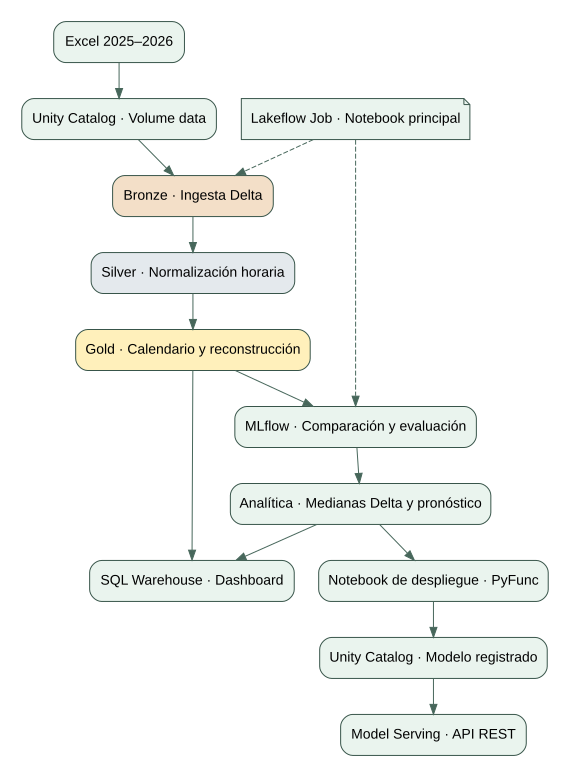
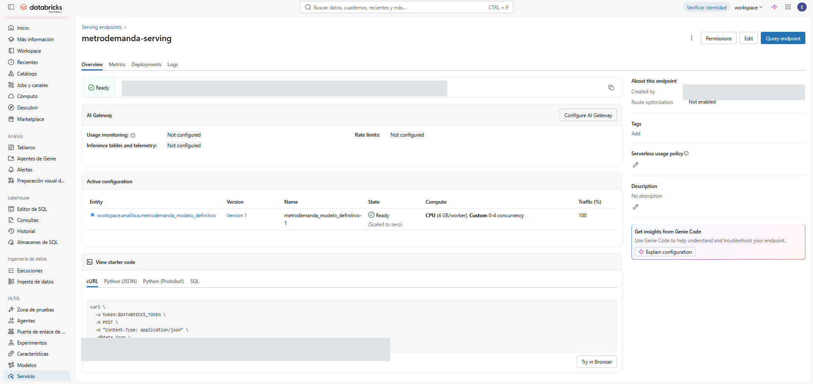
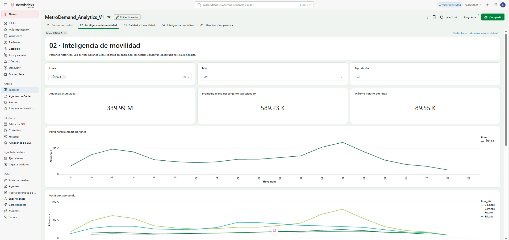

# 🚇 MetroDemand Analytics

   

  

**Diseño e implementación de una solución Big Data para el análisis y predicción de la demanda horaria de pasajeros del Metro de Medellín.**

**Universidad Autónoma Latinoamericana (UNAULA)**  
Especialización en Analítica de Datos · Big Data · 2026

### Integrantes

- Isis Valentina Palacio Taborda
- Yuliana Estrada Calle
- Dora Milena Estrada Muñoz
- Maria Antonia Pino Giraldo

## 🎯 1. Contexto y propósito

La demanda del transporte masivo presenta variaciones por línea, hora y tipo de día. Contar con información histórica consistente y estimaciones de demanda permite identificar patrones de movilidad y aportar evidencia a la planificación operativa. El proyecto aborda, además, la ausencia de registros históricos mediante una reconstrucción controlada y trazable.

### Objetivo general

Implementar una solución integral de ingeniería de datos y analítica predictiva que permita consolidar, analizar y estimar la demanda horaria de cinco líneas del Metro de Medellín.

### Objetivos específicos

- Integrar y transformar las fuentes originales mediante una arquitectura Medallion.
- Identificar faltantes, evaluar estrategias de imputación y reconstruir la serie histórica sin utilizar información futura.
- Comparar modelos predictivos mediante validación temporal y una prueba independiente.
- Registrar y desplegar el modelo seleccionado para consultar predicciones mediante una API REST.
- Comunicar los resultados mediante un dashboard interactivo.

## 📂 2. Alcance y fuentes de datos

| Característica | Descripción |
|---|---|
| Fuentes | Afluencia_Metro_2025.xlsx y Afluencia_Metro_2026.xlsx |
| Cobertura histórica | Enero de 2025 a julio de 2026 |
| Brecha principal | Octubre a diciembre de 2025 |
| Líneas objetivo | A, B, 1, 2 y T-A |
| Granularidad | Fecha, línea y franja horaria |
| Franjas de análisis | 04:00 a 23:00; no equivalen al horario efectivo de servicio |
| Horizonte predictivo | Agosto a diciembre de 2026 |

### Fuentes oficiales de información

Los datos de afluencia y los horarios de operación se obtuvieron de información pública del Metro de Medellín. El calendario de festivos nacionales complementa las variables temporales.

| Recurso | Fuente |
|---|---|
| Horarios de operación | [Metro de Medellín – Usuarios](https://www.metrodemedellin.gov.co/usuarios) |
| Portal de datos abiertos | [Afluencia de pasajeros](https://datosabiertos-metrodemedellin.opendata.arcgis.com/search?tags=afluencia) |
| Afluencia 2025 | [Descargar desde la fuente oficial](https://datosabiertos-metrodemedellin.opendata.arcgis.com/documents/d6bb62fc46db490db6f8783736969d15/about) |
| Afluencia 2026 | [Descargar desde la fuente oficial](https://datosabiertos-metrodemedellin.opendata.arcgis.com/documents/b9f146a80d1d41b498dac9bdc2838104/about) |

Consulte las [instrucciones de carga](data/README.md).

## 🏗️ 3. Arquitectura de la solución


### Diagrama técnico complementario



El diagrama técnico representa el flujo de datos y las dos rutas de consumo: visualización mediante tablas analíticas y consulta del modelo mediante un endpoint. El despliegue se realiza en un notebook separado del Job principal.

Las métricas de la infografía corresponden a la prueba independiente de julio, no a resultados observados del horizonte futuro; los beneficios son potenciales. La descripción técnica siguiente detalla las responsabilidades de cada capa.

| Componente | Función |
|---|---|
| Databricks | Entorno de ejecución y análisis |
| Apache Spark / PySpark | Transformación y procesamiento de datos |
| Delta Lake | Persistencia de tablas y resultados |
| Unity Catalog | Organización de volúmenes, tablas y modelos |
| Lakeflow Jobs | Orquestación del notebook principal |
| Spark MLlib | Evaluación de Random Forest |
| MLflow | Seguimiento de experimentos y empaquetado del modelo |
| Model Serving | Exposición del modelo registrado mediante API REST |
| SQL Warehouse y Dashboards | Consulta y visualización interactiva |

### Arquitectura Medallion

| Capa | Responsabilidad | Tabla principal |
|---|---|---|
| Bronze | Ingesta y conservación de datos originales | `metrodemanda_afluencia_raw` |
| Silver | Normalización y transformación a formato horario | `metrodemanda_afluencia` |
| Gold | Enriquecimiento de calendario y operación, reconstrucción histórica | `metrodemanda_afluencia_horaria_base`, `metrodemanda_afluencia_horaria_completa` |
| Esquema analítica | Comparación, evaluación, medianas persistidas y pronósticos | `metrodemanda_comparacion_modelos`, `metrodemanda_evaluacion_julio2026`, `metrodemanda_predicciones_ago_dic2026` |

## 🔎 4. Calidad y reconstrucción histórica

Se diferencian observaciones válidas, observaciones excepcionales fuera de horario, faltantes operativos y ceros estructurales. Se preservan los registros observados y se reconstruyen faltantes mediante métodos evaluados temporalmente: mediana histórica, mediana móvil estacional y Random Forest. Los cortes mensuales impiden que los datos del mes reconstruido participen en el ajuste.

| Indicador | Resultado |
|---|---:|
| Registros históricos consolidados | 57.700 |
| Registros imputados | 8.615 |
| Registros de pronóstico | 15.300 |

La imputación se distingue explícitamente de las observaciones originales. Consulte la [metodología](docs/metodologia.md) y el [diccionario de datos](docs/diccionario_datos.md).

## 📈 5. Modelado y evaluación predictiva

Se compararon tres escenarios: mediana histórica con observaciones, Random Forest con observaciones y Random Forest con observaciones e imputaciones. La selección se realizó por WAPE en junio de 2026; julio se reservó como prueba independiente. Posteriormente se reajustó el modelo ganador con información disponible hasta julio.

**Modelo seleccionado: mediana histórica sobre registros observados**, con niveles de respaldo por línea, hora y calendario. La selección favorece el desempeño observado, no la complejidad del algoritmo.

| Métrica de prueba independiente (julio de 2026) | Resultado |
|---|---:|
| WAPE | 10,01 % |
| MAE | 830,05 |
| RMSE | 2.143,69 |
| R² | 0,9737 |
| Registros evaluados | 2.885 |

Estas métricas no constituyen una garantía de precisión para agosto–diciembre de 2026.

[Experimentos MLflow](docs/evidencias/08_Experimentos_MLflow.png) · [Ajuste definitivo](docs/evidencias/09_Ajuste_Definitivo.png)

## ⚙️ 6. Orquestación y ejecución

El Job `MetroDemand_Analytics_Pipeline` ejecuta la ingesta, transformación, reconstrucción y predicción mediante una tarea de notebook en cómputo Serverless. La ejecución documentada fue manual y terminó satisfactoriamente en **17 minutos y 21 segundos**. No incluye despliegue automático del modelo.


[Configuración del Job](pipelines/job_config.json) · [Tarea de procesamiento](docs/evidencias/07_Pipeline_Tareas.png)

## 🚀 7. Registro, despliegue y API REST

El modelo definitivo se persiste en tablas Delta de medianas y se empaqueta como MLflow PyFunc. Se verifica su equivalencia con los 15.300 registros de pronóstico y se registra en Unity Catalog como `workspace.analitica.metrodemanda_modelo_definitivo`, versión 1. El endpoint `metrodemanda-serving` se documentó en estado Ready.



Ejemplo de solicitud:

```json
{"dataframe_records": [{"linea": "LÍNEA A", "hora_num": 7, "dia_semana_num": 2, "es_festivo": 0, "en_horario_operacion": 1}]}
```

Respuesta obtenida para ese escenario:

```json
{"predictions": [{"demanda_predicha": 54879}]}
```

El servicio recibe variables de calendario y operación precalculadas. La prueba funcional múltiple devolvió cinco predicciones; no sustituye la evaluación estadística.

[Registro del modelo](docs/evidencias/13_Registro_Unity_Catalog.png) · [Prueba API](docs/evidencias/11_API_Predicciones.png) · [Instrucciones de consumo](serving/README.md)

## 📊 8. Visualización y análisis

El dashboard interactivo se diseñó y publicó directamente en Databricks, utilizando las tablas Delta de la solución como fuentes de información. La versión publicada `MetroDemand_Analytics_V1` integra cinco módulos:

| Módulo | Propósito |
|---|---|
| Centro de control | Resumen histórico y predictivo |
| Inteligencia de movilidad | Patrones horarios y por tipo de día |
| Calidad y trazabilidad | Cobertura, procedencia e imputación |
| Inteligencia predictiva | Comparación y evaluación del modelo |
| Planificación operativa | Exploración de la demanda futura estimada |



[Dashboard publicado en PDF](dashboards/dashboard_publicado.pdf) · [Descripción del dashboard](dashboards/README.md)

## 🗂️ 9. Estructura del repositorio

```text
MetroDemand-Analytics/
├── README.md
├── requirements.txt
├── .gitignore
├── data/          # Fuentes y ubicación de carga
├── notebooks/     # Procesamiento y despliegue
├── pipelines/     # Configuración del Job
├── dashboards/    # Evidencia del dashboard publicado
├── serving/       # Cliente REST y ejemplos JSON
└── docs/          # Arquitectura, metodología y evidencias
```

## 🛠️ 10. Reproducción

1. Disponer del catálogo `workspace` y volumen `default.data`; cargar los Excel de las fuentes públicas según [fuentes](data/README.md).
2. Importar el [notebook principal](notebooks/MetroDemand_Analytics.ipynb) como `MetroDemand_Analytics_Version_Final` y ejecutar en Serverless. Utilizar un entorno aislado: el notebook crea esquemas y sobrescribe tablas.
3. Crear el Job con la [configuración](pipelines/job_config.json), sustituyendo la ruta del usuario. No ejecutar reset sobre el Job original.
4. Ejecutar el [notebook de despliegue](notebooks/MetroDemand_Model_Deployment.ipynb) después del principal y crear el endpoint con la versión registrada.
5. Configurar las variables de entorno `DATABRICKS_HOST` y `DATABRICKS_TOKEN` localmente; consultar las [instrucciones de API](serving/README.md). No publicar credenciales.
6. Consultar la [documentación del dashboard](dashboards/README.md) y su exportación PDF. La visualización interactiva se configuró en Databricks.

## 💡 11. Alcance, limitaciones y aporte

La solución permite explorar patrones de movilidad, anticipar escenarios de demanda y aportar soporte a decisiones basadas en datos. No mide mejoras efectivas de experiencia, ahorro de recursos, capacidad disponible ni frecuencias óptimas; estos son posibles usos posteriores de los resultados.

Los notebooks se adaptaron para publicación eliminando salidas y metadatos de sesión y parametrizando referencias del entorno. Se validó su estructura y sintaxis localmente, pero no se reejecutaron las versiones portables en Databricks. El cliente REST externo tampoco se probó contra el servicio; las evidencias corresponden a pruebas en la interfaz. El PDF documenta la visualización publicada; no es un archivo de importación de dashboards. Los datos de entrada se obtienen de los enlaces oficiales indicados en la sección de fuentes.

[Consultar las 13 evidencias de implementación](docs/evidencias/).
